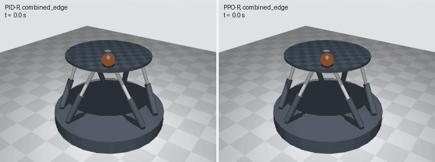
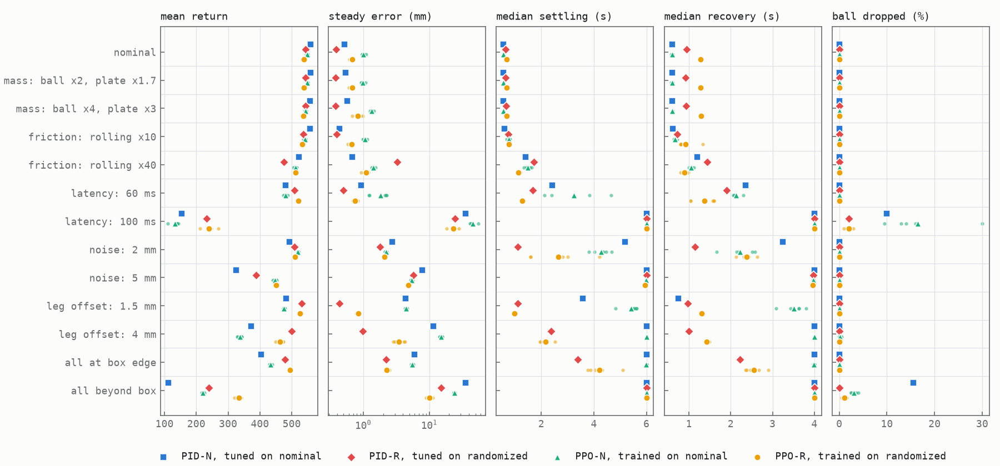
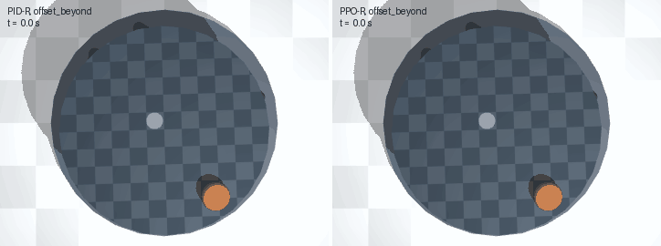
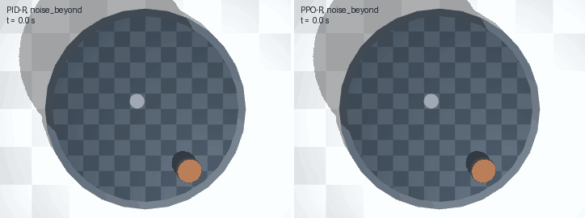
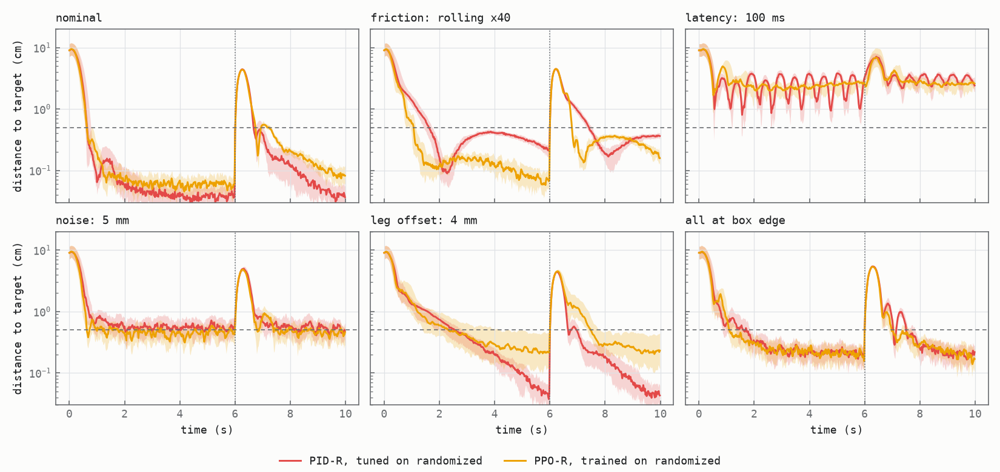
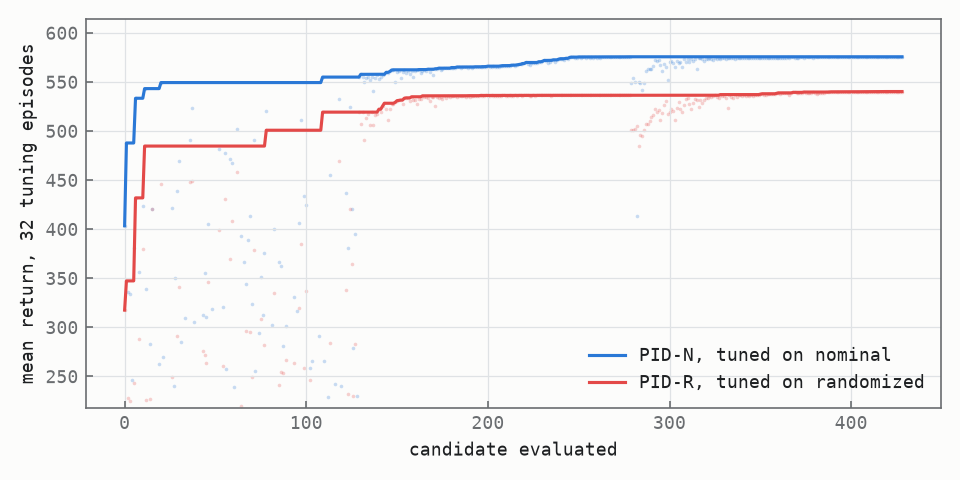
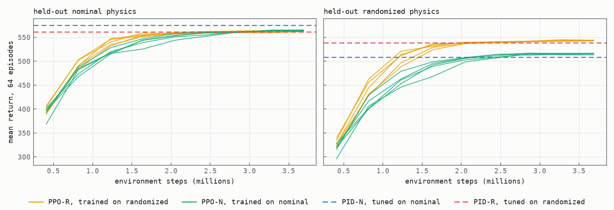
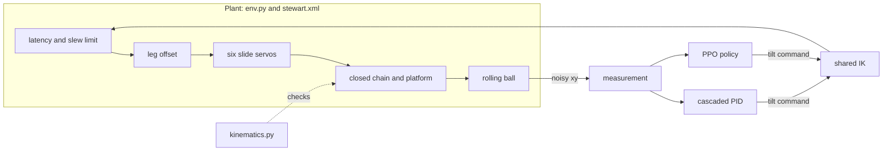

# stewartgym

[](https://github.com/matejpopovski/stewartgym/actions/workflows/ci.yml)

A simulated six-actuator Stewart platform balances a rolling ball. PPO, written from scratch, plays against a cascaded PID that was tuned hard enough to win on nominal physics, and both are scored on the same seeded episodes under shifted physics. The closed-chain model is hand-written MJCF and is checked numerically against independent kinematics before any controller touches it.



*Rendered from the simulation with `mujoco.Renderer`: first test seed, mass, friction, latency, noise and leg offset all shifted at once. PID on the left, PPO on the right.*

**The short answer.** Neither controller wins everywhere. PID is better on nominal physics, on mass changes and on actuator offset. PPO trained with domain randomization is better on sensor noise, on 60 ms latency and when several things are wrong at once. At 100 ms latency nothing works.

**Sim-to-real has not been done.** Everything here is sim-to-sim: both the training physics and the shifted physics come from the same MuJoCo model, and no hardware exists. A policy that survives a shift here has shown nothing about a real platform.

## Results

Four controllers, 200 test episodes per condition, and identical seeds for every controller. The letters say what each one saw during design: N for nominal physics, R for the randomization box.

- **PID-N**: PID tuned on nominal physics.
- **PID-R**: PID tuned on the randomization box.
- **PPO-N**: PPO trained on nominal physics, five seeds.
- **PPO-R**: PPO trained on the randomization box, five seeds.

PID-R exists because PPO-R saw a distribution of plants, and comparing it only with a PID that saw one plant would flatter it. Each cell is mean episode return, the quantity both controllers were optimised for. PPO spread is the standard deviation across five training seeds. The interval is a paired two-level bootstrap over training seeds and episodes, and the winner column is named only when that interval excludes zero. In each pair of rows, the first sits at the edge of the randomization box and the second beyond it.

<!-- results:start -->
| Physics | PID-N | PID-R | PPO-N | PPO-R | PPO-R minus PID-R (95% CI) | Winner |
|---|---:|---:|---:|---:|---:|---|
| nominal | 559.3 | 543.7 | 548.6 ± 1.9 | 538.1 ± 1.9 | -5.6 (-7.4, -3.8) | PID-R |
| mass: ball x2, platform x1.7 | 558.9 | 543.8 | 549.2 ± 1.8 | 538.2 ± 1.9 | -5.6 (-7.5, -3.8) | PID-R |
| mass: ball x4, platform x3 | 557.9 | 543.7 | 543.5 ± 1.5 | 536.0 ± 2.7 | -7.7 (-10.1, -5.3) | PID-R |
| friction: rolling x10, sliding x0.25 | 557.2 | 537.0 | 540.9 ± 2.3 | 533.2 ± 2.0 | -3.8 (-5.7, -2.0) | PID-R |
| friction: rolling x40, sliding x0.1 | 521.8 | 475.8 | 511.1 ± 4.2 | 511.1 ± 3.4 | +35.3 (+33.0, +38.4) | PPO-R |
| latency 60 ms | 480.4 | 508.1 | 480.3 ± 5.2 | 521.4 ± 3.5 | +13.3 (+10.3, +16.0) | PPO-R |
| latency 100 ms | 153.3 | 231.8 | 133.6 ± 13.5 | 240.0 ± 20.8 | +8.1 (-8.6, +24.7) | tie |
| sensor noise 2 mm | 493.5 | 508.8 | 519.4 ± 1.2 | 510.7 ± 1.1 | +1.9 (+0.7, +3.2) | PPO-R |
| sensor noise 5 mm | 325.0 | 387.7 | 446.8 ± 4.7 | 451.2 ± 2.9 | +63.6 (+61.0, +66.2) | PPO-R |
| leg offset 1.5 mm | 482.5 | 530.4 | 475.6 ± 2.5 | 526.4 ± 2.5 | -4.0 (-6.3, -1.7) | PID-R |
| leg offset 4 mm | 372.8 | 499.2 | 336.7 ± 6.2 | 463.3 ± 10.2 | -35.9 (-46.3, -26.6) | PID-R |
| all of the above at box edge | 403.7 | 479.4 | 433.6 ± 3.1 | 493.9 ± 2.4 | +14.6 (+12.0, +16.4) | PPO-R |
| all of the above beyond box | 112.0 | 240.2 | 220.8 ± 3.3 | 333.9 ± 9.0 | +93.8 (+83.1, +102.8) | PPO-R |

<details>
<summary>Control metrics for PID-R and PPO-R on every scenario (PPO-R values are means over five seeds)</summary>

| Physics | Controller | Settled | Settling, median | Steady error | Recovered | Recovery, median | Kick peak | Dropped | Action rate |
|---|---|---:|---:|---:|---:|---:|---:|---:|---:|
| nominal | PID-R | 100% | 0.64 s | 0.38 mm | 100% | 0.95 s | 44.2 mm | 0.0% | 0.096 |
| nominal | PPO-R | 100% | 0.67 s | 0.68 mm | 100% | 1.28 s | 43.3 mm | 0.0% | 0.094 |
| mass: ball x2, platform x1.7 | PID-R | 100% | 0.64 s | 0.38 mm | 100% | 0.92 s | 44.3 mm | 0.0% | 0.096 |
| mass: ball x2, platform x1.7 | PPO-R | 100% | 0.68 s | 0.67 mm | 100% | 1.27 s | 43.5 mm | 0.0% | 0.095 |
| mass: ball x4, platform x3 | PID-R | 100% | 0.66 s | 0.38 mm | 100% | 0.93 s | 44.3 mm | 0.0% | 0.096 |
| mass: ball x4, platform x3 | PPO-R | 100% | 0.68 s | 0.83 mm | 100% | 1.29 s | 43.8 mm | 0.0% | 0.104 |
| friction: rolling x10, sliding x0.25 | PID-R | 100% | 0.75 s | 0.40 mm | 100% | 0.72 s | 43.7 mm | 0.0% | 0.096 |
| friction: rolling x10, sliding x0.25 | PPO-R | 100% | 0.76 s | 0.66 mm | 100% | 0.91 s | 43.3 mm | 0.0% | 0.097 |
| friction: rolling x40, sliding x0.1 | PID-R | 100% | 1.71 s | 3.26 mm | 99% | 1.44 s | 44.6 mm | 0.0% | 0.097 |
| friction: rolling x40, sliding x0.1 | PPO-R | 100% | 1.12 s | 1.10 mm | 100% | 0.89 s | 44.8 mm | 0.0% | 0.110 |
| latency 60 ms | PID-R | 100% | 1.67 s | 0.50 mm | 100% | 1.90 s | 53.6 mm | 0.0% | 0.100 |
| latency 60 ms | PPO-R | 100% | 1.28 s | 0.75 mm | 100% | 1.37 s | 52.5 mm | 0.0% | 0.092 |
| latency 100 ms | PID-R | 0% | 6.00 s | 24.69 mm | 2% | 4.00 s | 74.8 mm | 2.0% | 0.139 |
| latency 100 ms | PPO-R | 3% | 6.00 s | 23.00 mm | 3% | 4.00 s | 76.4 mm | 2.0% | 0.123 |
| sensor noise 2 mm | PID-R | 100% | 1.10 s | 1.80 mm | 99% | 1.14 s | 45.9 mm | 0.0% | 0.320 |
| sensor noise 2 mm | PPO-R | 99% | 2.64 s | 2.07 mm | 99% | 2.38 s | 45.0 mm | 0.0% | 0.211 |
| sensor noise 5 mm | PID-R | 47% | 6.00 s | 5.71 mm | 52% | 3.98 s | 50.7 mm | 0.0% | 0.771 |
| sensor noise 5 mm | PPO-R | 60% | 5.96 s | 4.82 mm | 59% | 3.96 s | 49.3 mm | 0.0% | 0.373 |
| leg offset 1.5 mm | PID-R | 100% | 1.10 s | 0.43 mm | 100% | 0.97 s | 44.2 mm | 0.0% | 0.096 |
| leg offset 1.5 mm | PPO-R | 100% | 0.97 s | 0.83 mm | 100% | 1.30 s | 43.8 mm | 0.0% | 0.090 |
| leg offset 4 mm | PID-R | 100% | 2.37 s | 0.99 mm | 100% | 1.00 s | 44.7 mm | 0.0% | 0.096 |
| leg offset 4 mm | PPO-R | 80% | 2.17 s | 3.48 mm | 80% | 1.43 s | 45.9 mm | 0.0% | 0.081 |
| all of the above at box edge | PID-R | 98% | 3.38 s | 2.22 mm | 96% | 2.22 s | 54.6 mm | 0.0% | 0.321 |
| all of the above at box edge | PPO-R | 97% | 4.22 s | 2.28 mm | 97% | 2.56 s | 54.0 mm | 0.0% | 0.201 |
| all of the above beyond box | PID-R | 7% | 6.00 s | 15.01 mm | 10% | 4.00 s | 71.7 mm | 0.0% | 0.727 |
| all of the above beyond box | PPO-R | 20% | 6.00 s | 10.04 mm | 23% | 4.00 s | 70.3 mm | 1.1% | 0.320 |

</details>
<!-- results:end -->

Regenerate with `uv run --frozen python scripts/report_tables.py`. A test fails if these tables stop matching `results/summary.json`.



*Small dots are individual PPO seeds, markers are means. Settling and recovery are capped at the phase length (6 s and 4 s) when the ball never stays inside the 5 mm band.*

What the numbers say:

- **PID wins nominal.** PID-N scores 559.3 against 548.6 for PPO-N and 538.1 for PPO-R. PPO-N matches its settling time (0.56 s both) with about double the steady error (1.01 mm against 0.52 mm).
- **PID wins on actuator offset, by the most where it matters.** At 4 mm leg offset, PID-R holds 0.99 mm and settles every episode, while PPO-R holds 3.48 mm and settles 80%. An integrator cancels any constant bias. The policy has learned a trim for offsets up to the 1.5 mm it saw.
- **PID-N does not survive offset either.** It tuned its integrator almost away (`ki_vel` 0.10) because nominal physics has no bias to remove, so at 4 mm it scores 372.8 against 499.2 for PID-R. Tuning on the nominal plant bakes in assumptions, for classical control as much as for learning.
- **PPO wins on noise.** At 5 mm of sensor noise PPO-R scores 451.2 against 387.7, with steady error 4.82 mm against 5.71 mm and half the action rate (0.37 against 0.77). PID differentiates noise and passes it to the plate.
- **PPO wins when shifts combine.** All shifts at the box edge: 493.9 against 479.4. All beyond the box: 333.9 against 240.2, though no controller settles more than about a fifth of those episodes.
- **Randomization is not free.** PPO-R gives up 10.4 return against PPO-N on nominal physics. In exchange it gains 126.6 at 4 mm offset and 106.3 at 100 ms latency.
- **Training seeds barely differ.** PPO-R spread across five seeds is under 4 return on ten of thirteen conditions. The largest, 20.8, is at 100 ms latency, where the ball is close to falling.

Against PID-R alone the score is six wins to PID-R, six to PPO-R and one tie. If PID were allowed the better of its two tunings per condition, which requires knowing the condition in advance, PID would take seven, PPO-R five, with the 100 ms tie unchanged.

| Where PID wins | Where PPO wins |
|---|---|
|  |  |
| Leg offset 4 mm. PID-R, left, ends on the target. PPO-R stops 9 mm short on this seed. | Sensor noise 5 mm. PID-R, left, moves the plate about twice as hard (action rate 0.77 against 0.37). |



*Median and quartiles over 48 episodes, for PID-R and PPO seed 0. Dashed line is the 5 mm band. Dotted line is the kick at 6 s. Dropped balls are held at 15 cm so they count in the quantiles.*

## The mechanism

MuJoCo bodies form a tree, and a Stewart platform is a closed chain through six legs. The model in [`stewart.xml`](src/stewartgym/assets/stewart.xml) cuts each loop at the top of the leg: every leg is a universal joint and an actuated slide, the platform is a free body, and six equality `connect` constraints close the chain at the spherical joints.

That leaves 24 tree DoF and 18 closure rows. A model like this can be wrong in ways that look fine. The `connect` constraint can infer its second anchor from the initial pose, which silently absorbs a mistyped coordinate, so this model names both sites and a 1 mm typo fails a test. Soft constraints stretch rather than break, so the checks below measure the gap instead of assuming it is closed.

Each check compares the simulator with something that does not depend on it. [`kinematics.py`](src/stewartgym/kinematics.py) has the IK, the forward-kinematics solver and the Jacobian, and never imports MuJoCo.

| Check | Measured | Reference |
|---|---|---|
| Closure Jacobian rank across 25 poses | 18 | 18, so mobility 24 - 18 = 6, which matches Grubler for 6-UPS |
| Rank with all six slides locked | 24 | 24: the actuators determine the whole mechanism |
| Slide rates of closure null-space motions against analytic Jacobian | 3.4e-7 per unit velocity | 0 |
| IK against settled pose, zero gravity, 40 poses | 0.6 µm, 0.8 µrad | 1 µm, the coordinate rounding in the MJCF |
| IK against settled pose, gravity on | 0.48 mm, 1.0 mrad | Servo compliance, expected at finite stiffness |
| Leg length against IK of the measured pose, gravity on | 14 µm | 0: this one has no servo in it |
| One leg stepped 0.1 mm against inverse Jacobian | 25 nm | 0 |
| Largest loop gap, legs driven at 0.5 m/s | 0.50 mm | Transient, soft closure |
| Largest loop gap in a task episode with the kick | 0.31 mm | Transient, soft closure |
| Energy rise while coasting with no drive or damping | 2.6e-7 relative | Must not be positive by much |
| Rolling acceleration on a held 4 degree tilt | 0.4880 m/s² | 0.4901, 5/7 g sin(t), a 0.44% error |
| The same with rolling resistance on | 0.4811 m/s² | 0.4831, a 0.42% error |
| Sliding acceleration past the slip limit, mu 0.02 | 1.1737 m/s² | 1.1747, g(sin(t) - mu cos(t)), a 0.09% error |
| Ball path at 2 ms against 0.25 ms timestep | 0.05 mm | Sets the 2 ms physics step |

Reproduce with `uv run --frozen python scripts/validate_model.py`, which writes `results/model_validation.json`. The rolling check caught something in passing: MuJoCo floors friction coefficients at 1e-5, so setting rolling friction to zero leaves a small residual. Only dropping to `condim` 3 removes it.

## Why this is harder than a ball on a plate

Around level the ball is a double integrator, which any textbook controller handles. Three things make it less forgiving. Sensing, control and actuation add 20 ms of delay at nominal and 100 ms in the worst case, against a loop that wants to cross over near 1 Hz. Velocity is not measured, so it must be estimated from noisy positions, where every filter adds more delay. And rolling resistance gives the plant a deadband, in which an integrator can charge up while the ball is stuck.

Choices made, and what they replaced:

- **Both controllers command a tilt, and the same IK maps it to six legs.** A policy acting directly on six legs would spend samples relearning kinematics, and a difference from PID would not be attributable to feedback.
- **Latency, slew limit and leg offset live inside the plant.** Controllers only see them through the ball.
- **The policy sees what PID sees.** Ten frames of noisy error and past actions, the target, and two slow filters (time constant 1.5 s) of error and action. Ten frames cover 200 ms, too short to see a constant bias, and the slow filters give a feed-forward network the long memory an integrator has. A recurrent policy was the alternative, at the price of a more complicated PPO.
- **Same objective on both sides.** The PID tuner maximises the same return, on the same episode distribution, that PPO does. Tuning PID on ITAE and training PPO on reward would compare two different goals.
- **Scoring uses the true ball position.** Controllers never see it.
- **Workers run the policy themselves.** The first version stepped envs and returned to the learner each tick, so every control tick waited for the slowest process. Collecting whole rollouts in the workers removes that per-tick wait, which matters on a busy machine, and running the policy in NumPy keeps torch out of them.
- **MJX was not used.** The project runs on CPU, and MuJoCo steps this model fast enough that a port was not needed: a median of 95.7k physics steps per second on one core over 15 trials with the ball in contact (`scripts/measure_step_rate.py`, `results/step_rate.json`). That is `mj_step` alone, measured on the Apple M3 Max while it was shared with other jobs, at a 1-minute load average of 7.5 on 14 cores. The file records the host and load, and the number will move with both.

## Giving PID a real chance

The baseline is a cascade: position error to speed setpoint, then PID on speed error to ball acceleration, with conditional integration and an optional integrator deadband. The tuner searched seven parameters in log space:

1. Score an analytic loop-shaped design, as a starting point.
2. Run 128 Sobol candidates over the gain box on 32 episodes each.
3. Run 150 Nelder-Mead evaluations from each of the top two, on the same fixed episodes, which makes the objective deterministic.
4. Pick the winner among those four on 256 fresh episodes.

Every candidate is logged in `results/pid_tuning_nominal.json` and `results/pid_tuning_robust.json` (the file name for PID-R). Both refinements on nominal reached the same score within 0.2, 575.3 and 575.1, from different starting points, which is good evidence the structure is exhausted rather than the search.

| | kp_pos | v_max | kp_vel | ki_vel | kd_vel | filter | deadband | Return on fresh seeds |
|---|---:|---:|---:|---:|---:|---:|---:|---:|
| Loop-shaped, nominal | 2.51 | 0.40 | 10.05 | 6.32 | 0 | 8.0 Hz | 1.0 mm | 400.1 |
| Hand-set defaults, nominal | 3.00 | 0.40 | 6.00 | 2.00 | 0 | 8.0 Hz | 0 | 543.9 |
| **PID-N**, nominal | 3.57 | 1.50 | 5.19 | 0.10 | 0.001 | 2.6 Hz | 0.7 mm | 575.3 |
| **PID-R**, randomized | 2.56 | 0.19 | 4.66 | 3.07 | 0.001 | 2.2 Hz | 1.1 mm | 539.4 |

The derivative gain ended at or next to the bottom of its range (0.001) both times, so the D term does no useful work at this sample rate and noise level, and the filter settled near 2 to 3 Hz. Stopping at the loop-shaped gains would have flattered PPO by about 175 return.



Each tuning took about four minutes.

## PPO

[`ppo.py`](src/stewartgym/ppo.py) is about 350 lines of PyTorch: separate actor and critic MLPs (256, 256, tanh), a state-independent log std, GAE, running observation normalisation, per-minibatch advantage normalisation and a KL early stop. Time limits are bootstrapped from the value of the state that was cut off, because a time limit is not a failure and the observation does not show the clock. The curriculum raises start distance, target spread, kick size and randomization width over the first 40% of steps.

The tests train it on a point-mass task with a known answer in a few seconds, compare NumPy inference with torch, and assert that two runs with one seed give identical weights.

Training ran on CPU with 8 worker processes and 8 environments each, 4 million steps per run, five seeds for each of two conditions. That took 53.5 minutes of wall clock for ten runs, on an Apple M3 Max (14 cores, 36 GB) shared with unrelated jobs. Hyperparameters came from common values and short probe runs, including one full 4M-step run, with no sweep. The matrix was restarted once after fixing the order of the observation-normalisation update, and only the final run is reported.



*Greedy return on 64 held-out episodes, one line per seed. Dashed lines are the tuned PIDs on the same episodes. These use the training episode distribution, so they differ from the test table.*

## How scoring works

A test episode starts the ball at rest 6 to 12 cm from the centre with a target within 6 cm, gives it 6 s to settle, then adds a 0.3 m/s kick and allows 4 s to recover. Plate radius is 15 cm, the ball is 2 cm in radius, control runs at 50 Hz with physics at 500 Hz, tilt is limited to 8 degrees and leg command slew to 0.25 m/s.

A seed fixes the start, target, kick direction, sensor noise and leg offsets through separate random streams, so noise does not depend on how a controller behaves. Rerunning 800 of the test episodes on the same machine (PID-R and PPO-R seed 0, on nominal physics and 4 mm offset) gave a maximum return difference of exactly 0.0 from the committed `results/episodes.csv.gz` (`scripts/check_reproducibility.py`, `results/reproducibility.json`).

- **Settling time**: first entry into the 5 mm band after which the ball stays inside until the kick.
- **Steady-state error**: mean distance over the last 2 s before the kick.
- **Disturbance rejection**: peak distance after the kick, and recovery time to the same 5 mm band.
- **Action rate**: RMS tick-to-tick change in action, which penalises a controller that wins by chattering.

Physics in the table is either on the edge of the training box or beyond it. Tests enforce that each scenario is on the side it claims. Tuning, selection, validation and test use disjoint seed ranges.

## Failure analysis

**100 ms latency.** Nothing settles. The ball is about 2.5 cm off target through the whole hold phase, PID-R oscillates through it and PPO-R stays near a constant distance, and 2% to 16% of episodes drop. With velocity estimated through a low-pass filter, 100 ms of delay leaves too little phase for this loop. PPO's training box stopped at 60 ms and PPO-N, which never saw latency change, is worst here at 16.5% dropped with one seed at 30%.

**4 mm leg offset.** The largest PID-R win. PPO-R's trim works by reading slow filters and it was only ever rewarded for bias up to 1.5 mm. Integral action has no such range. This is a structural advantage of the classical controller on a shift of this shape, and a wider randomization box would only move the limit.

**Rolling friction x40.** PID-R's weakest condition relative to PPO-R: 3.26 mm steady error against 1.10 mm. The ball reaches the target by about 2 s, then drifts up to 4 mm away and creeps back, as the integrator charged during the slow approach bleeds off. Rerunning PID-R with the integrator off cuts the error to 1.50 mm (`scripts/check_integrator.py`, `results/integrator_check.json`), which confirms the cause. PID-N barely integrates and holds 0.68 mm. The tuning that handles offset is the tuning that hurts here.

**The analytic design scored worst.** The loop-shaped starting point came in at 400.1 on fresh seeds, below the hand-set defaults. Its crossover was chosen from a linear margin calculation that does not see the penalty on action rate or the sensor noise, and the tuner moved it to half the velocity gain and a filter a third as fast.

**Steady error on nominal.** PPO's steady error of 0.7 to 1.0 mm stays above PID's 0.4 to 0.5 mm on nominal physics and on the mass shifts. A likely cause, not separately tested, is exploration noise: training ends with an action standard deviation near 0.12 of full scale, about 1 degree of tilt, and return has little gradient left below 1 mm.

## Reproduce

Python 3.12 and [uv](https://docs.astral.sh/uv/). The lockfile pins CPU torch on Linux and Mac.

```bash
uv sync --frozen
uv run --frozen pytest
```

Then each stage on its own, with at most eight worker processes at any time:

```bash
uv run --frozen python scripts/validate_model.py            # model checks, a few seconds
uv run --frozen python scripts/tune_pid.py                  # PID-N, about 4 min
uv run --frozen python scripts/tune_pid.py --randomize      # PID-R, about 4 min
uv run --frozen python scripts/train_all.py                 # ten runs, about 55 min
uv run --frozen python scripts/evaluate.py                  # 200 episodes on each pair
uv run --frozen python scripts/report_tables.py             # the tables above
uv run --frozen python scripts/check_integrator.py          # the friction check
uv run --frozen python scripts/check_reproducibility.py     # 800 episodes against the saved ones
uv run --frozen python scripts/measure_step_rate.py         # one-core mj_step rate, overwrites the file
uv run --frozen python scripts/make_figures.py
uv run --frozen python scripts/render_gifs.py combined_edge --camera bench
uv run --frozen python scripts/render_gifs.py offset_beyond noise_beyond --camera top
```

To evaluate without retraining, the ten policies are in `policies/` as small NumPy archives. Evaluation needs no torch.

Rendering uses `mujoco.Renderer`, which needs an OpenGL context. The GIFs were made on a Mac with CGL, and Linux rendering was not tried. CI runs on Linux x86-64 with no display and sets `MUJOCO_GL=disable`, so the render test is skipped there while the physics tests and a short training smoke test run.



## Limitations

- **No hardware.** Sim-to-sim only. Transfer to a real platform was not attempted, and nothing here predicts it. The "shifted" plant shares its contact model, MJCF and solver with the training plant.
- **Idealised actuators.** Legs are position servos with viscous damping and a force limit. There is no backlash, stiction or encoder quantisation.
- **Idealised sensing.** Sensor noise is white Gaussian on position at a fixed rate. A real camera or resistive panel has correlated noise, dropouts and jitter.
- **The closure is soft.** Loop gaps reach 0.31 mm in a task episode. That is small next to the 20 mm of leg travel at full tilt, but it is not a rigid joint, and the constraint time constant cannot go below twice the 2 ms step.
- **A limited PID.** It is one structure with fixed gains. A Kalman filter, a Smith predictor or gain scheduling would be natural next moves for noise and latency, so "PPO beats PID" here means this PID, not classical control.
- **Only tilt is learned.** The policy never drives legs separately, and heave and yaw stay at home.
- **The winner column rests on return.** Return blends accuracy and smoothness with weights chosen for this project. PID-R often has the lower steady error on conditions it loses: noise at 2 mm, and combined at the box edge (2.22 mm against 2.28 mm).
- **Statistics.** Intervals are not corrected for 13 comparisons, and five seeds is a small sample of training runs. Some wins, such as 1.9 return at 2 mm noise, are real in this sample and too small to matter.
- **Scenarios are hand-picked.** They cover one shift at a time plus two combinations. Interactions were not explored.
- **Training time.** The final matrix took 53.5 minutes of wall clock (`results/training/wall_clock.json`). Probe runs and one restarted matrix ran on top of that and were not separately recorded.
- **Resume is not bit-exact.** Checkpoints restore the learner but not worker RNG state or episodes in progress.

MIT licence.
